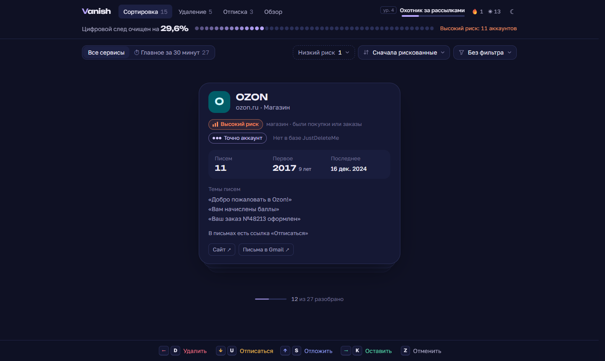
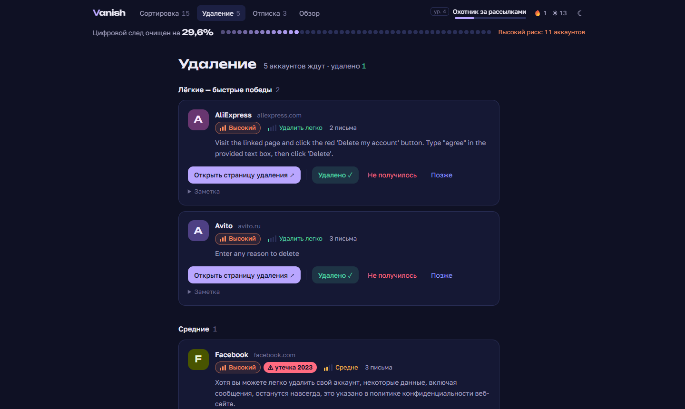
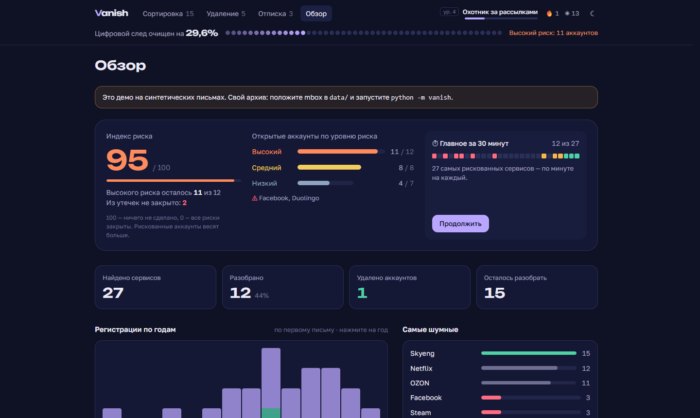

# Vanish

Vanish находит сервисы, где вы зарегистрированы, по архиву Gmail и помогает **быстро найти и закрыть самые рискованные аккаунты**: магазины с сохранёнными картами, банки, соцсети, сервисы, которые уже были в утечках. Разбор устроен как игра: карточка за карточкой вы решаете судьбу аккаунта (удалить, оставить, отписаться), а низкорисковую мелочь убираете одной кнопкой.

Всё работает на вашем компьютере: почта никуда не отправляется, регистрация и ключи не нужны.



## Быстрый старт

1. Установите [Python 3.10+](https://www.python.org/downloads/). На Windows при установке отметьте «Add python.exe to PATH».
2. Скачайте Vanish: зелёная кнопка **Code → Download ZIP** на GitHub (и распакуйте) или `git clone`.
3. Посмотрите демо на выдуманных письмах: `python -m vanish demo` (на macOS/Linux — `python3 -m vanish demo`).
4. Закажите свой архив в Google Takeout ([как — ниже](#где-взять-архив)), положите `.mbox` в папку `data/` и запустите **`start.bat`** (Windows) или **`start.command`** (macOS) двойным щелчком. Либо из консоли: `python -m vanish`.

Интерфейс откроется в браузере сам.

## Приватность

- Всё работает только на вашем компьютере. Сервер слушает `127.0.0.1` и не принимает запросы с чужих сайтов.
- Из архива читаются только заголовки писем (отправитель, тема, дата, `List-Unsubscribe`). Тексты писем не читаются и не сохраняются. Из «Спама» запоминается только факт, что письма с домена сервиса туда попадали.
- Данные из почты никуда не отправляются. Иконки сервисов не загружаются, вместо них буква на цветном фоне.
- Сетевых запросов два, оба — только по вашей команде и оба без ваших данных:
  - `update-jdm` скачивает публичную базу JustDeleteMe;
  - `update-breaches` скачивает публичный каталог утечек Have I Been Pwned (`/api/v3/breaches`, без ключа). Это общий список «какой сервис когда утёк» — ваши адреса и домены туда не передаются, сопоставление идёт локально.
- Копии обеих баз уже лежат в проекте, так что без этих команд всё работает офлайн.
- Архив лежит в `data/`, результаты разбора — в `state/`. Обе папки есть в `.gitignore`.

**Проверьте сами.** Сетевые запросы есть только в двух файлах, `vanish/jdm.py` и `vanish/breaches.py`, и выполняются только командами `update-jdm` и `update-breaches`. Найти все места, где код обращается к сети: `grep -rn "urllib.request" vanish/` (Windows: `findstr /s /n "urllib.request" vanish\*.py`). Интерфейс запрещает браузеру загружать что-либо с чужих сайтов заголовком Content-Security-Policy.

## Что нужно

- **Python 3.10+.** Сторонние пакеты не нужны, используется только стандартная библиотека.
- **Node.js 20.19+** — только если вы меняете интерфейс. Собранный интерфейс уже лежит в `vanish/static/`.

Проверить версию Python: `python --version`. На Windows можно также использовать `py`. **На macOS и Linux** во всех командах ниже пишите `python3` вместо `python`.

## Где взять архив

1. Откройте [takeout.google.com](https://takeout.google.com).
2. Нажмите «Отменить выбор» и отметьте только **Почта**. Формат — mbox.
3. Создайте экспорт. Google пришлёт письмо со ссылкой, обычно в течение суток.
4. Распакуйте архив и положите `.mbox`-файл из папки `Takeout/Почта` в папку `data/` проекта (обычно он называется «Вся почта, включая спам и корзину.mbox»). Переименовывать его не нужно, можно положить и всю распакованную папку `Takeout` — файлы `.mbox` ищутся во вложенных папках. Если Google разбил экспорт на несколько частей (`takeout-…-001.zip`, `-002.zip`), распакуйте все: mbox лежит целиком в одной из них.

Размер файла не важен: он читается потоково, в консоли виден прогресс. Архив на ~300 тысяч писем разбирается за 1–3 минуты. Если прервать анализ (`Ctrl+C`), база останется как до запуска, и его можно просто запустить заново.

## Запуск

Все команды выполняются из корня проекта (папки, где лежит этот README).

```
python -m vanish
```

Команда анализирует архив из `data/` (при первом запуске) и открывает интерфейс в браузере. Остановить — `Ctrl+C`. При следующих запусках анализ не повторяется, сразу открывается интерфейс.

То же самое делает двойной щелчок по `start.bat` (Windows) или `start.command` (macOS). Если macOS не даёт открыть `start.command` («неизвестный разработчик»), щёлкните по нему правой кнопкой → «Открыть».

Хотите сначала попробовать без своих данных? Демо на синтетических письмах:

```
python -m vanish demo
```

Демо хранится отдельно (`state/demo.db`) и не смешивается с вашими данными. Начать демо заново: `python -m vanish demo --reset`.

### Все команды

| Команда | Что делает |
|---|---|
| `python -m vanish` | Анализ (если ещё не было) и интерфейс |
| `python -m vanish analyze [файлы…]` | Импорт mbox: все `*.mbox` из `data/` или указанные файлы |
| `python -m vanish serve` | Только интерфейс. Флаги: `--port 8765`, `--no-browser` |
| `python -m vanish demo` | Демо на синтетических письмах |
| `python -m vanish update-jdm` | Обновить базу JustDeleteMe |
| `python -m vanish update-breaches` | Обновить список утечек Have I Been Pwned |
| `python -m vanish build` | Пересобрать интерфейс (нужен Node.js) |

Если порт 8765 занят, Vanish возьмёт следующий свободный и покажет адрес в консоли.

## Повторный импорт почты

Сделайте новый экспорт в Takeout, положите файл в `data/` и выполните:

```
python -m vanish analyze
```

Новые письма добавятся к уже найденным, дубликаты отбрасываются. Ваши решения, заметки, очки и достижения сохраняются. Если архив был импортирован до появления оценки риска или кнопки «Отписаться», повторите `analyze` с тем же файлом. Vanish досчитает темы, признаки покупок, ссылки отписки и письма в «Спаме». Можно указать файл явно: `python -m vanish analyze "D:\Takeout\mail.mbox"`.

Свои адреса Vanish определяет сам (по заголовку `Delivered-To` и папке «Отправленные»). Если у вас были другие адреса, письма с которых в архиве выглядят как от сервиса, укажите их: `python -m vanish analyze --me old@example.com`.

## База JustDeleteMe

Из [JustDeleteMe](https://github.com/jdm-contrib/jdm) берутся название сервиса, ссылка на удаление аккаунта, инструкция и сложность удаления. Копия базы уже лежит в `vanish/resources/jdm_sites.json`, поэтому всё работает офлайн. Обновить её:

```
python -m vanish update-jdm
```

После обновления перезапустите `python -m vanish`: новые данные применятся ко всем сервисам, повторный анализ не нужен.

## Список утечек Have I Been Pwned

Каталог утечек [Have I Been Pwned](https://haveibeenpwned.com) (лицензия CC BY 4.0) лежит в `vanish/resources/hibp_breaches.json`. Сервисы из него помечаются значком «⚠ утечка». Обновить:

```
python -m vanish update-breaches
```

Как и с JustDeleteMe, достаточно перезапустить интерфейс.

## Оценка риска

Каждый сервис получает балл 0–100 и уровень: **высокий** (от 55), **средний** (30–54), **низкий** (до 30).

| Что учитывается | Баллы |
|---|---|
| Категория: финансы, магазины, доставка, такси, билеты и поездки, госуслуги, медицина, соцсети, вакансии, знакомства | 50 |
| Категория не определена (обычный сервис) | 25 |
| Рассылки, новости, блоги | 5 |
| В темах писем есть покупки: заказ, чек, оплата, квитанция, order, receipt, invoice, payment… | +20 |
| Сервис был в утечке после вашего первого письма от него | +25, и уровень не ниже среднего |
| Утечка была раньше вашего первого письма (возможно, вас не задела) | +15 |
| Уверенность: точно аккаунт / вероятно / только рассылка | +10 / +5 / −10 |

Категория берётся в таком порядке: справочник доменов (`vanish/resources/categories.json` — его можно дополнять), слова в домене (`bank`, `shop`, `taxi`, `.gov`…), темы писем. Темы вроде «дайджест» или «новости недели» не понижают риск сервиса, где у вас точно есть аккаунт.

Риск пересчитывается при каждом открытии, поэтому правка справочника или обновление списка утечек применяются без повторного анализа почты.

## Как пользоваться

**Сортировка.** Сервисы показываются по одной карточке. Решение — свайпом или клавишей:

| Клавиша | Действие |
|---|---|
| `←` или `D` | Удалить аккаунт (в очередь на удаление) |
| `→` или `K` | Оставить |
| `↓` или `U` | Только отписаться от рассылки |
| `↑` или `S` | Отложить |
| `Z` | Отменить последнее действие |

По умолчанию сначала идут сервисы с высоким риском, внутри уровня — те, что были в утечках. Порядок и фильтр (например, «только высокий риск» или «только из утечек») меняются над карточкой.

**Главное за 30 минут.** Переключатель над карточкой показывает только 30 самых рискованных сервисов и отдельный прогресс по ним: по ячейке на сервис, цвет — ваше решение. Набор не меняется, пока вы разбираете, так что это законченная задача на полчаса.

**Быстрые действия.** Кнопка «Низкий риск» над карточкой открывает меню:
- «Рассылки → отписаться» — всем неразобранным сервисам низкого риска с рассылкой ставится «только отписаться»;
- «Все оставшиеся → пропустить» — остальной низкий риск помечается «пропущено» (считается разобранным, почти без очков).

Перед действием Vanish покажет, сколько и какие сервисы затронет. Передумали — `Z` отменяет всё действие разом.



**Удаление.** Очередь сгруппирована по сложности, лёгкие идут первыми, внутри группы — самые рискованные. «Открыть страницу удаления», затем «Удалено ✓», «Не получилось» или «Позже». Если сервиса нет в JustDeleteMe, будет кнопка поиска инструкции и поле для заметки.

**Отписка.** У каждого сервиса кнопка «Отписаться» открывает https-ссылку из заголовка `List-Unsubscribe` самого свежего письма (адреса `mailto:` не используются), так что в Gmail заходить не нужно. После перехода кнопка меняется на «Готово ✓». Рядом видно, на какой сайт ведёт ссылка и из какого она письма.

Кнопки нет, если сервису нельзя доверять: письма от него попадали в «Спам» или аккаунт не подтверждён (уверенность «вероятно» или «только рассылка»). Такие сервисы помечены «⚠ не нажимать — может подтвердить адрес спамерам», потому что переход по ссылке сообщает отправителю, что адрес живой. Для них остаётся ссылка на письма в Gmail, где их можно пометить как спам.

Vanish сам по ссылкам не ходит: страница открывается в браузере, только когда вы нажмёте кнопку. Ссылки хранятся в `state/vanish.db` и не попадают ни в CSV-отчёт, ни в экспорт прогресса.

**Обзор.** Сверху — **индекс риска**: 100 в начале, 0 — когда все риски закрыты (аккаунт удалён, осознанно оставлен или пропущен, отписка сделана). Рискованные аккаунты весят в индексе больше. Рядом — сколько аккаунтов высокого риска осталось, открытые утечки и прогресс «Главного за 30 минут». Ниже — итоги, регистрации по годам, самые шумные сервисы, достижения, полный список с поиском и фильтрами (решение любого сервиса можно поменять), ручное добавление сервиса, отчёт в CSV, экспорт и импорт прогресса в JSON.



## Как Vanish определяет аккаунты

- Письма группируются по корневому домену отправителя: `noreply@mail.ozon.ru` → `ozon.ru`. Составные зоны (`.co.uk`, `.com.ua`) учитываются по офлайн-копии Public Suffix List. Известные домены рассылок приводятся к сервису (`facebookmail.com` → `facebook.com`).
- Уверенность считается по темам писем на русском и английском: «Добро пожаловать», «Подтвердите email», «Код входа», «Сброс пароля», welcome, verify, password reset и т. п.:
  - **точно аккаунт** — есть явные признаки регистрации или входа;
  - **вероятно** — косвенные признаки (заказы, квитанции, бронирования и т. п.);
  - **только рассылка** — признаков аккаунта нет.
- Личная переписка с адресов почтовых сервисов (gmail.com, mail.ru, yandex.ru и др.), ваши собственные письма, спам и чаты не считаются сервисами.
- Домены, с которыми вы переписывались сами и без признаков аккаунта (например, рабочая почта знакомых), скрыты как переписка. Их можно найти в «Обзоре» фильтром «Скрытая переписка» и разобрать вручную.

## Очки

- Решение по сервису: 15 очков за высокий риск, 10 за средний, 5 за низкий. «Отложить» — 2, «пропустить» — 1.
- Подтверждённое удаление: очки за сложность (от 50 за easy до 200 за impossible), умноженные на риск: ×2 за высокий, ×1,5 за средний. Закрыть рискованный аккаунт выгоднее всего.
- Новые достижения: «Заделал брешь» (удалить аккаунт из утечки), «Минус десять рисков», «Главное сделано», «Ноль высокого риска».

## Где хранится прогресс

В файле `state/vanish.db` (SQLite) в папке проекта, а не в браузере: можно менять браузер, ничего не потеряется. Резервную копию решений делает кнопка «Экспорт прогресса JSON» в разделе «Обзор». Начать полностью заново — удалить `state/vanish.db` и снова запустить `python -m vanish`.

## Разработка

```
python -m venv .venv
.venv\Scripts\python -m pip install pytest        # macOS/Linux: .venv/bin/python
.venv\Scripts\python -m pytest
```

Тесты используют только синтетический mbox (`vanish/synthetic.py`), реальный архив для них не нужен.

Интерфейс: React + TypeScript + Tailwind в `web/`.

```
cd web
npm install
npm run dev      # http://127.0.0.1:5173, API проксируется на запущенный python -m vanish serve
npm run build    # сборка в vanish/static/
```

Структура:

```
vanish/            Python: анализатор, API, сервер, CLI
  mbox.py          потоковое чтение заголовков mbox
  psl.py           корневой домен по Public Suffix List
  signals.py       признаки аккаунта и фильтр личной переписки
  jdm.py           база JustDeleteMe: сопоставление и обновление
  breaches.py      список утечек Have I Been Pwned: сопоставление и обновление
  risk.py          оценка риска: категории, покупки, утечки
  analyzer.py      импорт и слияние с существующими данными
  store.py         схема SQLite
  game.py          очки, уровни, достижения, серии дней
  api.py, server.py  локальный API и раздача интерфейса
  resources/       офлайн-данные: PSL, JustDeleteMe, утечки HIBP, категории доменов,
                   почтовые сервисы, алиасы доменов
  static/          собранный интерфейс
web/               исходники интерфейса
tests/             тесты на синтетических данных
data/              ваш архив (не в git)
state/             база с результатами и прогрессом (не в git)
```

## Сообщить об ошибке

Заведите issue на GitHub. **Не прикладывайте свою почту**: никаких `.mbox`, `state/vanish.db`, экспортов прогресса, скриншотов со своими сервисами и тем писем. Если сервис определился неверно, достаточно его домена.

## Лицензия и оговорки

Код — [MIT](LICENSE). Данные JustDeleteMe, Have I Been Pwned и Public Suffix List, а также шрифты распространяются по своим лицензиям, см. [THIRD_PARTY.md](THIRD_PARTY.md).

Vanish не связан с Google, JustDeleteMe или Have I Been Pwned. Аккаунты он не удаляет сам: только подсказывает, где и как это сделать, а решение и действия остаются за вами. Оценка риска приблизительная и строится по заголовкам писем. Программа предоставляется «как есть», без гарантий.
